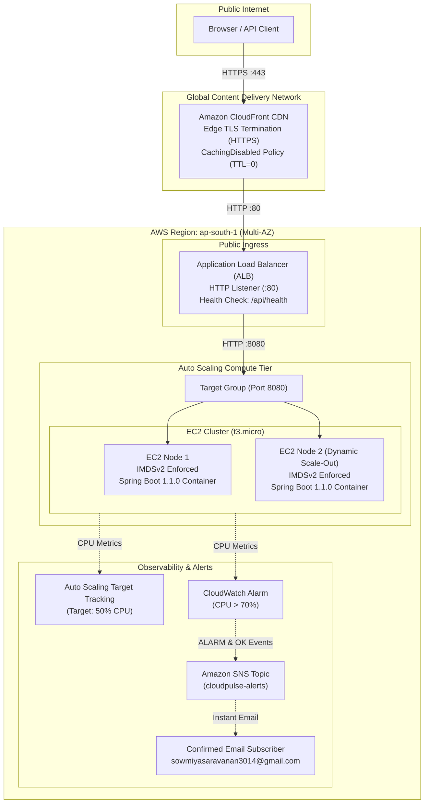

# CloudPulse — Highly Available Cloud Application Platform

[](https://www.oracle.com/java/)
[](https://spring.io/projects/spring-boot)
[](https://www.docker.com/)
[](https://www.terraform.io/)
[](https://aws.amazon.com/)

CloudPulse is a production-style, self-healing cloud microservice platform deployed on Amazon Web Services (AWS). It demonstrates automated continuous deployment, elastic auto-scaling, proactive health observability, CloudWatch alerting, and multi-layer cloud security hardening.

---

## Live Public Demo (HTTPS)
- **CloudFront CDN HTTPS URL**: [`https://d3v9i1q37unojr.cloudfront.net`](https://d3v9i1q37unojr.cloudfront.net)
- **Health Endpoint**: [`https://d3v9i1q37unojr.cloudfront.net/api/health`](https://d3v9i1q37unojr.cloudfront.net/api/health)
- **Info Endpoint**: [`https://d3v9i1q37unojr.cloudfront.net/api/info`](https://d3v9i1q37unojr.cloudfront.net/api/info)

---

## Architecture Diagram



---

## Key Engineering Highlights

1. **Edge SSL/TLS Termination with Amazon CloudFront**:
   - Provides a browser-trusted, resume-ready HTTPS endpoint on `*.cloudfront.net` using CloudFront's default certificate.
   - Configured with `Managed-CachingDisabled` ($TTL=0$) so dynamic API telemetry and hostnames are never cached.
   - Integrates `Managed-AllViewerExceptHostHeader` to safely rewrite the `Host` header to match ALB listener rules while preserving viewer headers and query strings.

2. **Automated CI/CD & Zero-Downtime Rolling Updates**:
   - Automated GitHub Actions pipeline ([`.github/workflows/ci.yml`](.github/workflows/ci.yml)) tests code with Maven, builds versioned Docker images, and pushes to Docker Hub (`sowmiyasaravanan14/cloudpulse`).
   - Triggers rolling deployments via AWS Auto Scaling Instance Refresh with post-deployment canary health checks.

3. **Elastic Auto Scaling & Target Tracking**:
   - Dynamically scales compute capacity between 1 and 3 instances based on a 50% average CPU utilization target tracking policy.
   - Validated via controlled scale-out/scale-in tests and round-robin request distribution across target group instances.

4. **Proactive CloudWatch Monitoring & SNS Dual Alerting**:
   - Monitors cluster CPU utilization using `cloudpulse-high-cpu` alarm.
   - Configured with automated dual-state SNS notifications dispatching real-time email alerts for both **ALARM** breaches and **OK** recovery events.

5. **Multi-Layer Cloud Security Hardening**:
   - **IMDSv2 Enforced**: Configured with `http_tokens = "required"` and `http_put_response_hop_limit = 1` in the EC2 Launch Template to prevent SSRF credential theft.
   - **Immutable Artifacts**: Pinned immutable commit-SHA Docker container digests to prevent configuration drift.
   - **Least Privilege**: Restrictive IAM policies for GitHub Actions, CloudWatch/SNS alerts, and CloudFront.
   - **Protected Endpoints**: Stress testing endpoints hardened with authentication and constant-time secret validation.

---

## API Endpoints

| Method | Path | Description | Sample Response |
| :--- | :--- | :--- | :--- |
| `GET` | `/api/health` | Real-time health status, container ID, and timestamp | `{"status":"UP","version":"1.1.0","instance":"c86669d8bef4"}` |
| `GET` | `/api/info` | Application metadata, Java version, and runtime OS | `{"app":"CloudPulse","version":"1.1.0","javaVersion":"21"}` |
| `POST` | `/api/stress` | Hardened stress testing endpoint (requires `X-Stress-Key`) | `{"error":"Stress testing endpoint is disabled on this instance."}` |

---

## Detailed Documentation Directory

For in-depth architectural analysis, interview preparation, and operational runbooks, refer to the documentation in [`docs/`](docs/):

- 📐 [**System Architecture & Component Design**](docs/ARCHITECTURE.md)
- 🧪 [**Empirical Test & Verification Evidence**](docs/TEST_EVIDENCE.md)
- 💼 [**Interview Notes & Technical Talking Points**](docs/INTERVIEW_NOTES.md)
- 💰 [**AWS Cost Review & Safe Teardown Guide (Step 7)**](docs/CLEANUP_AND_COST_GUIDE.md)
- 🔐 [**GitHub Actions Least-Privilege IAM Policy**](docs/iam-github-actions-policy.json)

---

## Quick Start & Local Development

### Prerequisites
- Java 21 & Maven 3.9+
- Docker

```bash
# Run locally
mvn clean verify
mvn spring-boot:run

# Build and run Docker container
mvn clean package
docker build -t cloudpulse:local .
docker run --rm -p 8080:8080 cloudpulse:local
```

---

## License
MIT License. Built for cloud and DevOps portfolio demonstration.
