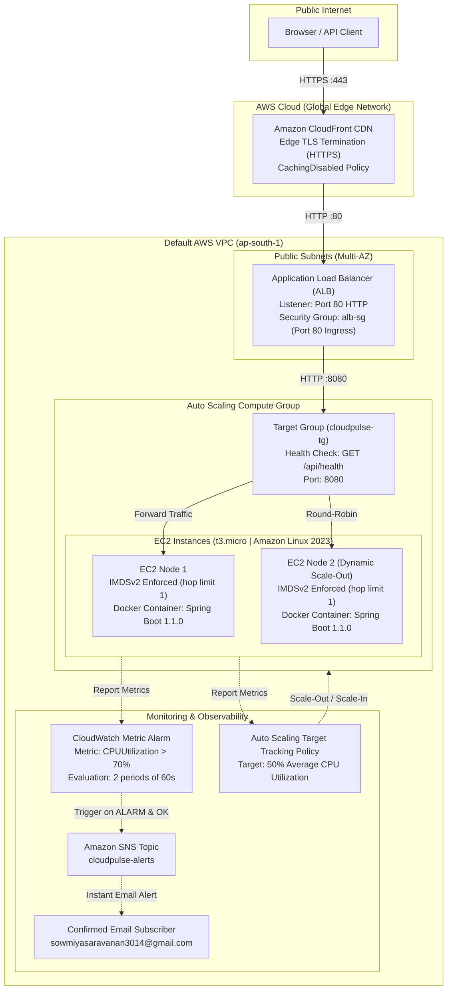

# CloudPulse Architecture & System Design

## Overview
CloudPulse is an enterprise-grade cloud-native monitoring and health application platform deployed on Amazon Web Services (AWS) using Terraform for Infrastructure-as-Code (IaC), Docker for containerization, and GitHub Actions for continuous integration and continuous deployment (CI/CD).

---

## Architecture Diagram

---

## Component Details

### 1. Edge Layer: Amazon CloudFront
- **Role**: Global edge distribution, DDoS mitigation, and SSL/TLS termination.
- **Protocol**: Accepts HTTPS (Port 443) from viewers with automatic HTTP-to-HTTPS redirect.
- **Certificate**: Free default certificate on `*.cloudfront.net`.
- **Cache Policy**: `Managed-CachingDisabled` (`4135ea2d-6df8-44a3-9df3-4b5a84be39ad`) ensures health metrics, instance IDs, and timestamps are always dynamically fetched from the origin in real time ($TTL=0$).
- **Origin Request Policy**: `Managed-AllViewerExceptHostHeader` (`b680b3d7-99aa-431f-8418-01f49d29c73f`) substitutes the origin domain in the `Host` header to match ALB listener routing while preserving custom client headers (e.g., `X-Stress-Key`).

### 2. Ingress & Routing: Application Load Balancer (ALB)
- **Role**: High-availability HTTP ingress distributed across multiple Availability Zones in `ap-south-1`.
- **Target Group**: Forwards traffic to backend instances on port `8080`.
- **Health Checks**: Sends periodic `GET /api/health` requests every 30 seconds; instances must return `200 OK` to receive production traffic.
- **Security Boundary**: Security group `cloudpulse-alb-sg` restricts ingress to HTTP traffic.

### 3. Compute & Elasticity: EC2 & Auto Scaling Group
- **Base AMI**: Amazon Linux 2023 (`al2023-ami-2023.*-x86_64`).
- **Instance Sizing**: `t3.micro` instances.
- **Launch Template**:
  - Enforces **IMDSv2** (`http_tokens = "required"`, `http_put_response_hop_limit = 1`).
  - Pins immutable container image digest tags (`sowmiyasaravanan14/cloudpulse:<commit-sha>`).
  - Automatic Docker daemon installation and systemd service management via `user_data`.
- **Elastic Target Tracking**: Automatically scales instances between 1 (minimum) and 3 (maximum) to maintain target average CPU utilization at 50%.

### 4. Continuous Integration & Continuous Deployment (CI/CD)
- **Pipeline Engine**: GitHub Actions ([`.github/workflows/ci.yml`](file:///C:/Users/RAMYA%20SOWMYA/Desktop/CLOUD/CloudPulse/CloudPulse/.github/workflows/ci.yml)).
- **Stages**:
  1. Automated Maven test execution (`mvn clean verify`).
  2. Multi-tagged Docker container build (`latest` and `${{ github.sha }}`).
  3. Image push to Docker Hub repository `sowmiyasaravanan14/cloudpulse`.
  4. Rolling deployment via AWS Auto Scaling Instance Refresh (`aws autoscaling start-instance-refresh`).
  5. Post-deployment canary health check verification against the live ALB endpoint.

### 5. Observability & Alerting: CloudWatch & SNS
- **Alarm**: `cloudpulse-high-cpu` monitoring `AWS/EC2` `CPUUtilization`.
- **Threshold**: Triggers when average CPU exceeds 70% over two 60-second evaluation intervals.
- **Dual-Action Notification**: Dispatches SNS alerts for both `ALARM` (breach notification) and `OK` (recovery notification) to `sowmiyasaravanan3014@gmail.com`.
